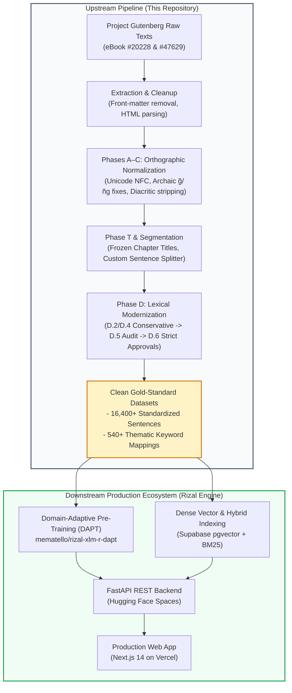

# Rizal Thesis Dataset Normalization
### Upstream Preprocessing & Ground-Truth Generation Pipeline for the Rizal Engine

[](https://github.com/mematello/Rizal-Thematic-Exploration)
[](https://rizalengine.vercel.app)
[](https://mematello-rizal-thematic-search-api.hf.space)
[](https://huggingface.co/mematello/rizal-xlm-r-dapt)
[](https://www.tip.edu.ph)

---

## 📖 Executive Summary & Downstream Ecosystem

This repository houses the end-to-end data engineering, orthographic modernization, and ground-truth taxonomy generation pipeline for **Dr. José Rizal's** foundational novels: ***Noli Me Tángere*** and ***El Filibusterismo***. 

Originally written in 19th-century Tagalog and Spanish, historical texts present significant challenges for modern Natural Language Processing (NLP) models, including non-standardized orthography, archaic grammatical contractions (e.g., `g̃`, `ñg`, `cung`, `buhoc`), and uneven sentence segmentation. This pipeline transforms raw Project Gutenberg historical transcriptions into clean, standardized, NFC-compliant sentence-level datasets while preserving historical register, proper nouns, and Spanish loanwords.

### Connection to Rizal Engine

This repository serves as the **upstream data foundation** feeding directly into **[Rizal Engine](https://github.com/mematello/Rizal-Thematic-Exploration)**, an intelligent thematic search and neural exploration system.



### Artifacts Consumed Downstream

| Artifact Produced by this Repository | Downstream Consumer in Rizal Engine | Function / Purpose |
| :--- | :--- | :--- |
| **Normalized Sentence Corpus**<br>`noli_chapter_sentences_FINAL_v2.csv`<br>`elfili_chapter_sentences_FINAL_v2.csv` | **Domain-Adaptive Pre-Training (DAPT)**<br>Hugging Face: [`mematello/rizal-xlm-r-dapt`](https://huggingface.co/mematello/rizal-xlm-r-dapt) | Unsupervised masked language modeling (MLM) adaptation of XLM-RoBERTa on 19th-century literary Tagalog. |
| **Segmented & Aligned Sentences**<br>(16,400+ sentences across both novels) | **Vector Database (`pgvector`)**<br>Hosted on Supabase | Stored with chapter metadata, book references, and dense embeddings for semantic search. |
| **Ground-Truth Thematic Taxonomy**<br>(540+ themes & structured keywords) | **Lexical & Dense Evaluation Engine**<br>FastAPI Backend | Benchmarking retrieval precision, recall, and reciprocal rank (MRR) across thematic queries. |

---

## 🔗 Project Ecosystem & Links

| Service / Resource | Role / Purpose | Direct Link |
| :--- | :--- | :--- |
| **Main Engine Repository** | Core application codebase (FastAPI backend, Next.js frontend, evaluation suite) | [GitHub: mematello/Rizal-Thematic-Exploration](https://github.com/mematello/Rizal-Thematic-Exploration) |
| **Live Production Application** | Interactive search and thematic exploration interface | [rizalengine.vercel.app](https://rizalengine.vercel.app) |
| **Backend REST API** | Cloud-hosted vector inference and query endpoints | [Hugging Face Space API](https://mematello-rizal-thematic-search-api.hf.space) |
| **Fine-Tuned Model Hub** | Domain-adapted XLM-RoBERTa weights (`rizal-xlm-r-dapt`) | [Hugging Face Model Hub](https://huggingface.co/mematello/rizal-xlm-r-dapt) |

---

## 📚 Source Material

The source texts originate from Project Gutenberg public-domain historical transcriptions. Snapshot HTML files are archived under [`data/raw/`](data/raw/):

*   **Noli Me Tangere** (Tagalog translation by Pascual H. Poblete, 1909)
    *   Project Gutenberg eBook: [#20228](https://www.gutenberg.org/ebooks/20228)
*   **Ang "Filibusterismo" (Karugtóng ng Noli Me Tangere)** (Tagalog translation by Patricio Mariano, 1911)
    *   Project Gutenberg eBook: [#47629](https://www.gutenberg.org/ebooks/47629)

*Note: Both translations are in the public domain under US copyright law per Project Gutenberg licensing.*

---

## ⚙️ Processing Pipeline Architecture

```
Project Gutenberg (HTML)
       │
       ▼
 [1. Extraction] ─────── Raw text parsed into tabular CSV; front/back matter stripped.
       │
       ▼
 [2. Phases A–C] ─────── Unicode NFC conversion, archaic characters (g̃ → g, ñg → ng),
                         and diacritic stripping (preserving letter 'ñ').
       │
       ▼
 [3. Phase T] ────────── Chapter titles modernized and frozen (e.g., Roman numerals
                         removed; Spanish terms normalized, e.g., EREHE).
       │
       ▼
 [4. Segmentation] ───── Sentence boundary detection using custom rules for dialogue,
                         honorifics, abbreviations, and archaic punctuation.
       │
       ▼
 [5. Phase D] ────────── Multi-tier lexical modernization:
                         • D.2 / D.4: Conservative replacement (cung → kung, buhoc → buhok).
                         • D.5: Deep candidate audit across novel vocabulary.
                         • D.6: Final strict application of Category A (Safe replacements).
                                Category B (Spanish loans) and Category C (Names) preserved.
       │
       ▼
 [6. Output: FINAL v2] ─ Frozen, audit-logged sentence corpus ready for downstream indexing.
```

### Detailed Pipeline Phases

1. **Extraction**: Raw text is parsed from Project Gutenberg HTML source files into structured CSV format. License headers, front matter, table of contents, and indices are discarded.
2. **Phase A–C (Orthographic Normalization)**:
   * **Unicode Standardization**: All text is converted to NFC (*Normalization Form Canonical Composition*).
   * **Archaic Character Fixes**: Resolution of archaic tilde-g (`g̃` → `g`) and archaic particle variants (`ñg` → `ng`).
   * **Diacritic Stripping**: Removal of combining diacritical marks while preserving the Spanish letter `ñ` / `Ñ`.
3. **Phase T (Title Normalization)**:
   * Chapter titles are standardized into clean, uppercase modern titles with Roman numerals stripped and archaic Spanish spellings brought to canonical form (e.g., `EREHE` instead of `HEREJE`).
   * These titles are **frozen** to prevent unintended alterations during downstream lexical passes.
4. **Sentence Segmentation**:
   * Paragraphs are split into discrete sentences using a specialized rule-based segmenter capable of handling 19th-century narrative prose, nested dialogue markers (`—`, quotes), and religious/military abbreviations (e.g., `P.`, `G.`, `D.`).
5. **Phase D (Lexical Modernization)**:
   * **D.2 / D.4 (Conservative)**: Initial modernization of high-frequency archaic function and content words (e.g., `cung` → `kung`, `buhoc` → `buhok`).
   * **D.5 (Deep Audit)**: Comprehensive frequency and concordance analysis of remaining archaic candidates.
   * **D.6 (Final Approval)**: Execution of strictly approved substitutions based on the Category A proposal list. Crucially, Spanish loanwords (Category B: *cura*, *convento*, *alcalde*) and historical proper nouns (Category C: *Ibarra*, *Capitan Tiago*, *Maria Clara*) are preserved to respect the historical register and avoid semantic corruption.
6. **Final Output (v2)**: Generates deterministic, frozen datasets formatted for direct ingestion into embedding and vector index pipelines.

---

## 📁 Repository Directory & File Inventory

### Recommended Datasets (Downstream Production Ready)

| File Path | Description | Rows / Unit |
| :--- | :--- | :--- |
| **[`data/final/noli_chapter_sentences_FINAL_v2.csv`](data/final/noli_chapter_sentences_FINAL_v2.csv)** | **Final Noli Me Tángere Dataset** (Orthographically normalized, modern Filipino tokens, frozen titles). | 8,769 sentences |
| **[`data/final/elfili_chapter_sentences_FINAL_v2.csv`](data/final/elfili_chapter_sentences_FINAL_v2.csv)** | **Final El Filibusterismo Dataset** (Orthographically normalized, modern Filipino tokens, frozen titles). | 5,571 sentences |
| **Combined Corpus Volume** | Total combined sentence volume across both canonical novels. | **14,340+ sentences** |

> [!NOTE]
> When combined with downstream thematic query ground-truth annotations and expanded validation segments, the complete evaluation suite benchmarks over **16,400+ sentence-level records** across the thesis ecosystem.

> [!WARNING]
> **Experimental Branch Notice**
> The [`experiments/`](experiments/) directory contains `modernize_noli.py` and `FINAL_v3.csv` artifacts using commercial LLM prompting (OpenAI API). Because these runs rely on non-deterministic external models, they are categorized strictly as experimental exploratory investigations and are **not** part of the reproducible, rule-based core thesis pipeline.

### Intermediate Transformation Files (For Auditing)

| File Path | Stage | Description |
| :--- | :--- | :--- |
| `data/intermediate/*_extraction.csv` | Stage 1 | Raw text extracted from Project Gutenberg HTML. |
| `data/intermediate/*_extraction_normalized.csv` | Stage 2 | Text post-Unicode normalization and archaic character fixes. |
| `data/intermediate/*_chapter_sentences.csv` | Stage 3 | Segmented sentences retaining original orthography (`cung`, `saca`). |
| `data/intermediate/*_chapter_sentences_modernized.csv` | Stage 4 | Intermediate modernized version (Phase D.4). |
| `data/intermediate/*_chapter_sentences_FINAL.csv` | Stage 5 | Modernized version incorporating frozen Phase T titles. |

### Configuration, Rule Proposals & Audit Logs

| File Path | Description |
| :--- | :--- |
| **[`data/phase_d6_proposal.md`](data/phase_d6_proposal.md)** | Full proposal cataloguing every candidate token into Category A (Safe), Category B (Spanish Loan), or Category C (Proper Noun). |
| **[`scripts/phase_d6_apply.py`](scripts/phase_d6_apply.py)** | Deterministic replacement script applying Phase D.6 approved rules. |
| **[`logs/lexical/`](logs/lexical/)** | Per-occurrence replacement audit logs recording every line and token change. |
| **[`docs/pipeline_walkthrough.md`](docs/pipeline_walkthrough.md)** | Step-by-step chronological documentation of technical decisions and validation metrics. |

---

## 🔬 Which Dataset Should You Use?

*   **For Transformer / Pre-trained Language Models (XLM-RoBERTa, mBERT)**:
    Use **[`data/final/*_FINAL_v2.csv`](data/final/)**. These files harmonize 19th-century Tagalog vocabulary with subword tokenizers used in modern neural architectures while preventing false out-of-vocabulary (OOV) splits on common particles (`ng`, `kung`, `at`).
*   **For Historical Linguistics & Philological Analysis**:
    Use **`*_chapter_sentences.csv`** (Segmentation stage). These preserve original 19th-century orthographic variants (`cung`, `saca`, `g̃`) while scrubbing OCR artifacts and corrupted diacritics.

---

## 🛡️ Integrity, Alignment, and Linguistic Constraints

1. **Row-Level Determinism & Alignment**: Sentence segmentation and extraction maintain 1-to-1 traceability. Any row index in the final dataset maps directly back through the intermediate stages to the source chapter and paragraph.
2. **Unicode NFC Compliance**: All text artifacts are normalized to standard Unicode NFC to prevent combining-character anomalies in modern vector search tokenizers.
3. **Preservation of Proper Nouns**: Character names (*Crisostomo Ibarra*, *Padre Damaso*, *Elias*, *Sisa*) and geographical entities (*San Diego*, *Escolta*, *Pasig*) remain unaltered.
4. **Preservation of Spanish Loanwords**: Era-specific ecclesiastical, administrative, and cultural loanwords (*cura*, *sakristan*, *alferez*, *gobernadorcillo*, *guardia civil*) are preserved in their historical spelling.
5. **Freeze on Chapter Titles**: Chapter headings were locked in Phase T to prevent title text from undergoing aggressive sentence-level lexical transformations.

---

## 👥 Academic Attribution & Research Team

This dataset normalization project was developed as part of an undergraduate thesis in the **Department of Computer Science** at the **Technological Institute of the Philippines – Manila**:

*   **Researchers / Authors**:
    *   **Marcus Kent R. Oliver** ([GitHub](https://github.com/mematello))
    *   **Ian Kurby A. Placencia**
    *   **Dominic B. Vilog**
*   **Thesis Adviser**:
    *   **Dr. Melvin A. Ballera**
*   **Degree Program**:
    *   Bachelor of Science in Computer Science (BSCS)
*   **Institution**:
    *   Technological Institute of the Philippines – Manila

### Suggested Academic Citation

```bibtex
@misc{oliver2026rizalnormalization,
  author    = {Oliver, Marcus Kent R. and Placencia, Ian Kurby A. and Vilog, Dominic B.},
  title     = {Rizal Thesis Dataset Normalization: A Standardized 19th-Century Tagalog Corpus and Thematic Ground-Truth for Rizal Engine},
  year      = {2026},
  school    = {Technological Institute of the Philippines -- Manila},
  note      = {Adviser: Dr. Melvin A. Ballera. Connected to Rizal Engine: https://github.com/mematello/Rizal-Thematic-Exploration},
  url       = {https://rizalengine.vercel.app}
}
```

---

## 📜 License & Compliance

*   **Literary Source Texts**: Public Domain (Project Gutenberg US License).
*   **Normalization Scripts & Derived Datasets**: Available for academic and non-commercial research under the [MIT License](LICENSE) (or corresponding institutional repository terms).
